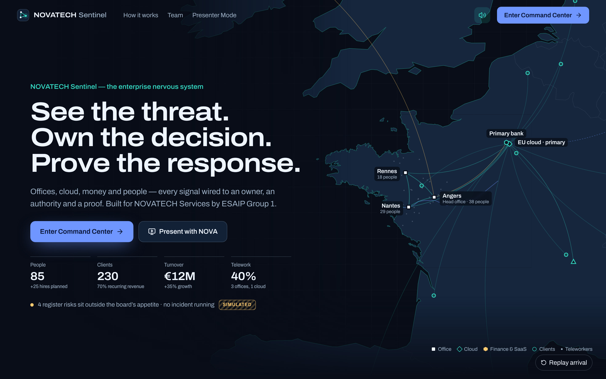
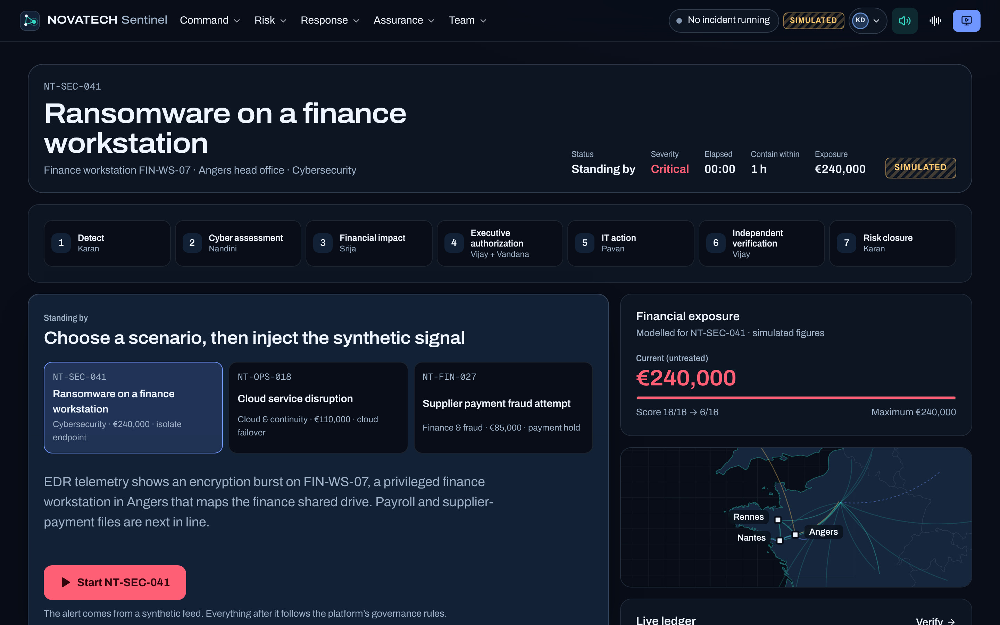
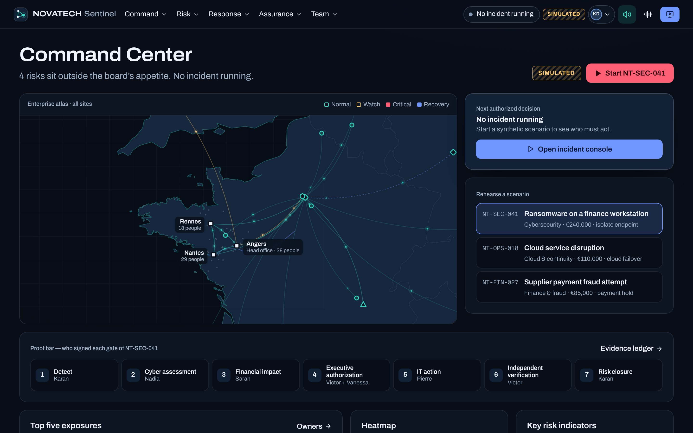
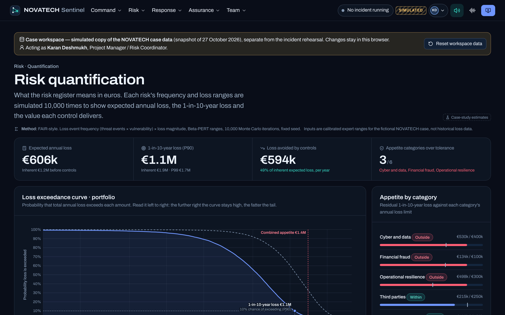

# NOVATECH Sentinel V2.4

**A governed risk-management command platform for the NOVATECH SERVICES case study**

ESAIP (Angers, France) · MSc · Risk Management course · **Group 1** · Academic year 2026–2027

**Live application:** <https://novatech-sentinel-v24.vercel.app/><br>
**Source package:** [`NOVATECH_Sentinel_V2.4_Full_Source.zip`](NOVATECH_Sentinel_V2.4_Full_Source.zip)

> [!IMPORTANT]
> **This is an academic simulation.** NOVATECH SERVICES is a fictional case company. Every alert, incident,
> telemetry value, financial figure and notification in the application is simulated and labelled
> **SIMULATED** in the interface. The public website cannot shut down, isolate or change any real device,
> network or payment. See [What is simulated and what is real](#5-what-is-simulated-and-what-is-real).



## Contents

1. [Project overview](#1-project-overview)
2. [Objectives](#2-objectives)
3. [Risk-management workflow](#3-risk-management-workflow)
4. [Key features](#4-key-features)
5. [What is simulated and what is real](#5-what-is-simulated-and-what-is-real)
6. [Technology stack](#6-technology-stack)
7. [Setup and local development](#7-setup-and-local-development)
8. [Testing and verification](#8-testing-and-verification)
9. [Repository structure](#9-repository-structure)
10. [Team](#10-team)
11. [Live application](#11-live-application)
12. [Source code and security](#12-source-code-and-security)
13. [Known limitations](#13-known-limitations)
14. [Further documentation](#14-further-documentation)

---

## 1. Project overview

**NOVATECH SERVICES** is the fictional case company of the course: an IT and digital-services firm with
85 employees, €12 million turnover (70 % recurring), 230 clients, three offices (Angers head office, Nantes and
Rennes), 40 % of staff teleworking, 35 % revenue growth and 25 planned hires. Its growth creates new exposure:
dependence on the cloud, identity attacks, supplier and payment fraud, overloaded delivery teams and new
regulatory obligations.

Group 1 analysed these risks and built **NOVATECH Sentinel** to show how a risk analysis becomes day-to-day
governance: every risk has an owner, every decision has an authority, and every response leaves evidence that
can be checked. In the application's own words: *See the threat. Own the decision. Prove the response.*

Version 2.4 brings three parts together in one web application:

| Part | What it contains | Main routes |
| --- | --- | --- |
| **Sentinel command experience** | Landing atlas, Command Center, the seven-gate incident workflow, evidence ledger, after-action report, Presenter Mode with NOVA voice narration | `/`, `/command`, `/incident`, `/evidence`, `/report`, `/present` |
| **Case workspace** | The 24 pages of the original NOVATECH integrated risk management (IRM) application (risk register, EBIOS RM, quantification, compliance, controls, policies, incidents, actions, approvals, vendors, continuity, board view, audit), running on a simulated snapshot of the case data | `/home`, `/risks`, `/ebios`, `/quant`, `/compliance`, … |
| **Archived V2.3 rehearsal** | The previous version, kept unchanged as a fallback | `/v2-demo` |

## 2. Objectives

**Academic objectives**

- Apply the complete risk-management process (context, identification, analysis, evaluation, treatment,
  monitoring and review) to a realistic SME case.
- Express risks in business terms: a likelihood × impact register, a board risk appetite, and financial
  exposure quantified in euros.
- Turn the analysis into governance: named risk owners, authority levels, separation of duties, delegation and
  escalation rules.
- Treat incident response as a governed, auditable process that links cybersecurity, finance, executive
  management and IT operations.
- Map controls to the normative and regulatory frameworks that apply to a European IT-services company.

**Project objectives**

- One application in which the board, the risk coordinator and each department see the same risk picture.
- A workflow in which no single person can request, approve, execute and verify the same action.
- Evidence that can be checked: who signed each step, when, and under which conditions.
- Honest labelling: everything simulated is marked as such, and real device actions stay outside the public
  website.

## 3. Risk-management workflow

### 3.1 The risk-management cycle (case workspace)

| Step | How NOVATECH Sentinel supports it |
| --- | --- |
| **Context** | Company profile and an atlas of NOVATECH's offices, EU cloud regions, bank, ERP, subcontracted developers and client clusters |
| **Identify** | Risk register R1–R8 and an EBIOS RM study, from business values to attack scenarios |
| **Analyse** | Likelihood (1–4) × impact (1–4) = score 1–16, on the course scale: 1–3 low, 4–7 moderate, 8–11 high, 12–16 critical |
| **Evaluate** | Board risk appetite: a score of 12 or more is outside tolerance; annual loss limits per risk category |
| **Quantify** | FAIR-style Monte Carlo simulation (10,000 iterations): expected annual loss, 1-in-10-year loss and the loss avoided by controls |
| **Treat** | A treatment option per risk (for example reduce or transfer), action plans with owners, and 25 controls mapped to ISO/IEC 27001, NIS2, GDPR and DORA |
| **Monitor and review** | Key risk indicators with warning and critical thresholds, control tests, continuity tests and vendor reviews |
| **Report** | Board view, audit trail and after-action report |

**Risk register (case snapshot)**

| Code | Risk | Owner | L | I | Score | Level | Target score | Treatment |
| --- | --- | --- | :-: | :-: | :-: | --- | :-: | --- |
| R1 | Cloud outage / business continuity | Pavan Sanam (IT Operations) | 4 | 4 | 16 | Critical | 8 | Reduce |
| R2 | Account compromise / cyber identity | Vijay Bhosale (CISO) | 3 | 4 | 12 | Critical | 6 | Reduce |
| R3 | Human error / onboarding / training | Camille Laurent\* (HR) | 3 | 3 | 9 | High | 6 | Reduce |
| R4 | Operational capacity / SLA failure | Julie Martin\* (Client Delivery) | 4 | 3 | 12 | Critical | 6 | Reduce |
| R5 | Supplier / subcontractor failure | Marc Dubois\* (Procurement) | 3 | 3 | 9 | High | 6 | Reduce / Transfer |
| R6 | Legal / compliance obligations | Sophie Girard\* (Legal & Compliance) | 2 | 3 | 6 | Moderate | 4 | Reduce |
| R7 | Supplier payment fraud (business email compromise) | Srija Poudapally (CFO) | 3 | 4 | 12 | Critical | 6 | Reduce |
| R8 | Unauthorised access to finance systems | Srija Poudapally (CFO) | 2 | 4 | 8 | High | 4 | Reduce |

\* Fictional NOVATECH employee, not a Group 1 member. R1–R6 come from the group's original analysis; R7 and R8
were added for Finance in the governance upgrade. Four risks (R1, R2, R4 and R7) are outside the board's
appetite.

### 3.2 Incident response: seven governed gates

When a risk materialises, Sentinel runs a governed workflow. Each gate has a named owner, a guiding question
and a signed form, and the gates are completed in order.

| # | Gate | Guiding question | Owner in the ransomware scenario |
| :-: | --- | --- | --- |
| 1 | Detect & take ownership | Is this real, and who owns it? | Karan Deshmukh, Risk Coordinator |
| 2 | Cybersecurity assessment | What is technically happening, and what is the safest treatment? | Nandini Vadlamudi, Cybersecurity Analyst |
| 3 | Financial impact | What could this cost the business? | Srija Poudapally, CFO |
| 4 | Executive authorization | Who is allowed to approve this, and do they? | Vijay Bhosale (CISO) and Vandana Madem (CEO) |
| 5 | Authorised IT action | Do exactly what was approved, nothing more. | Pavan Sanam, IT Operations Manager |
| 6 | Independent verification | Did it work? Checked by someone who did not do it. | Vijay Bhosale, CISO |
| 7 | Risk closure | What risk remains, and who owns the follow-up? | Karan Deshmukh, Risk Coordinator |

The workflow can be rehearsed with three scenarios:

| Reference | Scenario | Modelled exposure | Treatment |
| --- | --- | --- | --- |
| NT-SEC-041 | Ransomware on a finance workstation | €240,000 | Isolate the endpoint |
| NT-OPS-018 | Cloud service disruption | €110,000 | Cloud failover |
| NT-FIN-027 | Supplier payment fraud attempt | €85,000 | Payment hold |

The incident engine (`src/sentinel/engine/incident.ts`) enforces these governance rules:

- **Separation of duties.** An approver cannot be the requester or the executor, and dual control needs two
  different people. The executor cannot have approved the action, and the verifier cannot have executed or
  requested it. When the verifier also gave an approval, the platform discloses it instead of calling the
  check independent.
- **Policy-routed approvals.** A disruptive security action needs the CISO. When the modelled exposure is
  €100,000 or more, the CEO is added (dual control). A CFO who requests a payment hold cannot approve it
  herself, so the approval is routed to the CEO.
- **Return for revision and delegation.** An approver can send a treatment back for revision. When someone is
  unavailable, authority passes only to a pre-defined deputy for a limited time; if there is no eligible
  deputy, the step is blocked.
- **Signed hand-offs.** Each gate is a form, with fields such as severity (P1–P4), MITRE ATT&CK techniques, a
  low / likely / maximum loss range, approval conditions and validity, the change ticket, the verification
  method, residual risk and follow-ups. A form cannot be signed until it is complete.
- **Evidence.** Every event is sealed in a SHA-256 hash-chained ledger that can be verified, tamper-tested and
  exported from the Evidence page.



## 4. Key features

**Command and situational awareness**

- A landing atlas of NOVATECH's sites, cloud regions, bank, ERP, suppliers, client clusters and teleworker
  homes, drawn on Natural Earth geography.
- The Command Center shows the next authorised decision, current exposure, the top five risks, a heatmap, key
  risk indicators, open tasks and readiness.

**Governed incident response**

- Seven gates, three scenarios, signed forms, separation of duties, delegation and return for revision
  (section 3.2).
- *Challenge the controls*: what-if questions (the CEO is unavailable, the CEO sends the treatment back, the
  executor or the requester tries to approve) answered by the engine on a private copy and never recorded.
- Security operations view (`/soc`), department action plans and RACI (`/response`), and the authority map and
  delegation rules (`/team`).

**Evidence and reporting**

- An evidence ledger with chain verification and a tamper test (`/evidence`).
- An after-action report that states who signed each gate and under which conditions (`/report`).

**Case workspace (the original enterprise pages)**

- Risk register and heatmap, EBIOS RM, FAIR-style quantification, compliance across ISO/IEC 27001, NIS2, GDPR
  and DORA (4 frameworks, 53 requirements, 25 controls), control testing, policies, incidents, actions and
  approvals, vendors, business continuity, board pack and audit trail.
- It runs on a simulated copy of the case data. Changes stay in the visitor's browser, and **Reset workspace
  data** restores the snapshot. The read-only Internal Auditor persona can view everything but sign nothing.

**Presentation support**

- Presenter Mode offers nine shows in 2, 5, 8, 12, 20 and 30-minute versions, with a private console, an
  audience (projector) window, a phone script for each speaker, and a Q&A view in which every anticipated
  question has an owner, a short answer and a page that proves it.
- NOVA narration uses the browser's on-device voices, with captions and synthesized sound cues. Light and dark
  themes, projector contrast and reduced motion are supported.

**Security-conscious design**

- `vercel.json` adds security headers to every response: `X-Frame-Options: DENY`, `nosniff`, a strict referrer
  policy, and camera, microphone and geolocation disabled.
- No secrets in the browser bundle: only browser-safe publishable keys may use `VITE_` variables, and the
  optional relay keeps its secrets in server-side environment variables.
- Real device actions are opt-in, local, and require the device owner's explicit confirmation (section 5).

| Command Center | Risk quantification (case workspace) |
| --- | --- |
|  |  |

## 5. What is simulated and what is real

NOVATECH Sentinel is a classroom simulation. The table separates what the public website simulates from the
few operations that can affect a real device, which exist only in optional local tools run by the device's
owner.

| Capability | On the public website | Real-world effect |
| --- | --- | --- |
| Alerts, telemetry, key risk indicators, incidents, financial figures | Generated from a synthetic feed and fictional case data; labelled **SIMULATED** | None |
| People and access | The persona switcher chooses who the visitor acts as. It is a presentation convenience, **not authentication**. | None |
| Approvals, separation of duties, delegation | Real rule logic, evaluated in the visitor's browser | None. It demonstrates governance; it is not a security boundary. |
| Case-workspace data | A simulated in-browser backend holding a snapshot of the case data (27 October 2026); changes stay in that browser | None. A real database is used only when a build is configured with Supabase settings. |
| Evidence ledger | SHA-256 hash chain computed and stored in the browser | Detects edits to recorded events, but is not an independent, server-side audit trail |
| Notifications (inbox, e-mail, mobile push) | Simulated and labelled | None. No message is sent. |
| IT actions (isolate an endpoint, cloud failover, payment hold) | Simulated | None. No system is touched. |
| Final scene: power-off of the demonstration Mac for re-imaging | Simulated and labelled REHEARSAL, SIMULATED or PREVIEW | None from the public website |

**Real device operations (optional, outside the public website).** If the team chooses, the final scene can
power off one real computer: Karan's MacBook, which stands in for the compromised workstation FIN-WS-07. This
works only with local tools that the Mac's owner installs and starts himself:

- **Same-Mac helper** (`npm run helper:mac:live`) listens on `127.0.0.1` only and needs a temporary session
  code.
- **Private-LAN remote agent** (`npm run remote:live`) lets Pavan send a *request* from his laptop on the same
  Wi-Fi. He pairs with a six-digit code (valid for five minutes, five attempts) over HTTPS after checking the
  certificate fingerprint, and the pairing expires after 30 minutes.
- **Native approval on the device.** Every real request ends in a macOS confirmation on the Mac itself, with
  **Cancel or Reject as the default** and a 30-second timeout. Nothing powers off automatically, and no remote
  party can bypass the owner's decision.
- **Preview modes** (`npm run helper:mac`, `npm run remote:preview`) run the whole flow without sending any
  shutdown command, and the real shutdown paths refuse to run inside the automated test runner.

These tools are documented in [docs/DEVELOPER_GUIDE.md](docs/DEVELOPER_GUIDE.md),
[V2_DEMO_GUIDE.md](V2_DEMO_GUIDE.md) and [docs/NATIVE_COMPANION.md](docs/NATIVE_COMPANION.md). The repository
also contains an optional cloud relay (`api/remote.js`, [CLOUD_RELAY_SETUP.md](CLOUD_RELAY_SETUP.md)). It
stays disabled unless server-side secrets are provisioned, and its Mac-side integration is incomplete in this
version (see [Known limitations](#13-known-limitations)), so the public website cannot deliver a real request
to a device.

## 6. Technology stack

| Layer | Technology |
| --- | --- |
| Front end | React 18.3, TypeScript 5.6 (strict mode), React Router 6.26, lucide-react icons, self-hosted fonts (Fontsource) |
| Build tooling | Vite 5.4 with `@vitejs/plugin-react`, Node.js 22 |
| Demo data layer | In-browser simulated backend (`src/enterprise/demo`) with JSON fixtures; browser `localStorage` for state |
| Optional database | Supabase (PostgreSQL) through `@supabase/supabase-js`; schema in `supabase/sql/01_schema.sql` |
| Risk analytics | FAIR-style Monte Carlo (Poisson event frequency, Beta-PERT loss ranges, seeded random generator) |
| Evidence integrity | Dependency-free SHA-256 (FIPS 180-4) hash chain |
| Voice and sound | Web Speech API (speech synthesis) and Web Audio API (synthesized cues; no recorded audio) |
| Maps | Natural Earth geography (public domain) via world-atlas, simplified and embedded in the source |
| Hosting | Vercel: a static single-page application with rewrites and security headers, plus one optional serverless function (`api/remote.js`) backed by Upstash Redis when configured |
| Local companion (optional) | Node.js scripts (same-Mac helper, LAN agent with self-signed TLS, macOS LaunchAgent) and a Swift/SwiftUI package (`native/macos/NovatechApprover`) |
| Quality | Node.js built-in test runner (`node:test`), ESLint 9 with typescript-eslint |

## 7. Setup and local development

**Prerequisites:** Node.js 22.x (see `engines` in `package.json`) and npm. The simulation needs no account, API
key or environment variable.

```bash
git clone https://github.com/domail2karandeshmukh-cyber/novatech-sentinel-v24.git
cd novatech-sentinel-v24
npm ci              # install the exact dependency versions from package-lock.json
npm run dev         # development server at http://localhost:5173
```

Production build:

```bash
npm run build       # type-check (tsc -b) and build into dist/
npm run preview     # serve the production build at http://localhost:4173
```

**Optional configuration.** To connect the case workspace to a real Supabase database instead of the
simulated snapshot, copy `.env.example` to `.env.local` and set `VITE_SUPABASE_URL` and
`VITE_SUPABASE_PUBLISHABLE_KEY`. Only the **publishable** key belongs in a `VITE_` variable; never use a
`service_role` or secret key there. `.gitignore` keeps `.env` files out of Git.

**Deployment.** The live site is a separate Vercel project. From the project folder, run
`npx vercel@latest deploy --prod`. `vercel.json` provides single-page routing and the security headers.

**Presenting.** The scripts are in [docs/DEMO_SCRIPT.md](docs/DEMO_SCRIPT.md) (8 minutes),
[docs/DEMO_SCRIPT_20.md](docs/DEMO_SCRIPT_20.md) and [docs/DEMO_SCRIPT_30.md](docs/DEMO_SCRIPT_30.md).
Microsoft Edge provides the most natural NOVA voices.

## 8. Testing and verification

Verified on **4 November 2026** from a clean `npm ci` of this exact source (Node.js 22.23 on Linux):

| Check | Command | Result |
| --- | --- | --- |
| Type check and production build | `npm run build` | Pass |
| V2.3 regression | `npm run test:v2` | 10 / 10 pass |
| Incident engine, ledger, separation of duties, signed forms, shows, what-ifs | `npm run test:sentinel` | 44 / 44 pass |
| Simulated enterprise backend (parity with the original database rules) | `npm run test:enterprise` | 15 / 15 pass |
| Same-Mac helper | `npm run test:mac` | 6 / 6 pass |
| LAN remote pairing agent | `npm run test:remote` | 8 / 8 pass |
| Approval companion (Node side) | `npm run test:companion` | 55 / 55 pass |
| **Full suite (all of the above)** | `npm test` | **138 / 138 pass** |
| Cloud relay API (not part of `npm test`) | `node --experimental-strip-types --test tests/cloud-relay.test.mjs` | 4 / 4 pass |
| Local owner page (not part of `npm test`) | `node --experimental-strip-types --test tests/remote-local-admin.test.mjs` | 0 / 1, **fails** (see [Known limitations](#13-known-limitations)) |
| Lint, V2.4 code | `npm run lint:v24` | 0 errors, 19 warnings |
| Lint, whole project | `npm run lint` | 399 errors and 40 warnings, inherited from the original pages (397 of the errors are `no-explicit-any`) |
| Smoke test of the production build | Headless Chromium on `/`, `/command`, `/incident`, `/home`, `/quant`, `/evidence`, `/present` | All pages load with no page or console errors |
| Swift `ApproverCore` unit tests | `swift test` in `native/macos/NovatechApprover` | Not run in this check (no Swift toolchain available). The release notes record 27 / 27 passing on 28 October 2026. |

No automated test can power off a machine: the real shutdown and approval paths refuse to run inside the Node
test runner.

## 9. Repository structure

```text
novatech-sentinel-v24/
├── src/
│   ├── main.tsx            Entry point: Sentinel, or the archived V2.3 app under /v2-demo
│   ├── sentinel/           V2.4 Sentinel: pages, incident engine, ledger, presenter, NOVA voice
│   ├── enterprise/         Hosts the original pages; demo/ is the simulated backend with its fixtures
│   ├── pages/ components/ lib/ styles/   Original NOVATECH IRM enterprise application
│   └── v2/                 Archived V2.3 rehearsal
├── public/                 Favicon and static images
├── api/remote.js           Optional serverless cloud relay (disabled unless configured)
├── scripts/                Local-only Node tools: Mac helper, LAN agent, companion build, script export
├── native/macos/           Optional SwiftUI approval companion (Swift package with unit tests)
├── supabase/sql/           Database schema of the original application
├── tests/                  Automated test suites (node:test)
├── docs/                   Guides, demo scripts, release notes, design system, voice, screenshots
├── CLOUD_RELAY_SETUP.md    Optional cloud relay setup (incomplete, see Known limitations)
├── V2_DEMO_GUIDE.md        V2.3 demonstration sequence and security boundary
├── NOVATECH_Sentinel_V2.4_Full_Source.zip   Original source package
├── index.html, vite.config.ts, tsconfig*.json, eslint.config.js, vercel.json
├── package.json, package-lock.json
├── .env.example            Optional settings template (no values)
└── .gitignore
```

## 10. Team

ESAIP · MSc · Risk Management · **Group 1**. Each member plays a fictional NOVATECH role in the case and
presents one part of the story.

| Member | Role in the NOVATECH case | Accountable for | Presentation segment |
| --- | --- | --- | --- |
| **Karan Deshmukh** | Project Manager / Risk Coordinator | Risk programme and register; incident ownership and closure; coordination of every hand-off | Introduction; final demonstration and conclusion |
| **Vijay Bhosale** | RSSI / CISO | Security policy and cyber risk appetite; security authorisation of disruptive actions; independent technical verification | Security leadership |
| **Nandini Vadlamudi** | Cybersecurity Analyst | Detection and triage; incident investigation; cybersecurity action plan | Cybersecurity investigation |
| **Srija Poudapally** | Finance Director (CFO / DAF) | Financial impact assessment; payment controls and dual control on payments; finance action plan | Financial analysis |
| **Vandana Madem** | Chief Executive Officer | Company-level decisions; executive authorisation of high-impact actions (€100,000 or more) | Executive approval |
| **Pavan Sanam** | IT Operations Manager | Authorised technical execution only; infrastructure, endpoints and failover | IT execution |

Other NOVATECH people in the application (for example Thomas Bernard, Léa Moreau and the Internal Auditor) are
fictional and labelled as such.

## 11. Live application

**<https://novatech-sentinel-v24.vercel.app/>**

| Route | What to look at |
| --- | --- |
| `/` | Landing page and enterprise atlas |
| `/command` | Command Center |
| `/incident` | Seven-gate incident workflow: choose a scenario, then start it |
| `/evidence` | Evidence ledger: verify the chain and run the tamper test |
| `/report` | After-action report |
| `/present` | Presenter Mode |
| `/home` | Case workspace (the original enterprise pages) |
| `/quant` | Risk quantification |
| `/v2-demo` | Archived V2.3 rehearsal |

A suggested walkthrough: start a scenario from the Command Center, follow it through the seven gates, then
verify the chain on the Evidence page and read the after-action report. Everything is stored in your own
browser; **Settings** can reset it.

## 12. Source code and security

- **Complete source.** This repository contains the full source of NOVATECH Sentinel V2.4 at its root. Build
  and run it with the commands in [section 7](#7-setup-and-local-development).
- **Original package.** [`NOVATECH_Sentinel_V2.4_Full_Source.zip`](NOVATECH_Sentinel_V2.4_Full_Source.zip) is
  kept unchanged (SHA-256 `daf926cee5377eb45ed3865220f77492d79104639535c92a835df53f7d34b4e6`). The files in this
  repository are its extracted contents with two documentation changes: this README was rewritten for
  submission (the original is preserved as [docs/DEVELOPER_GUIDE.md](docs/DEVELOPER_GUIDE.md)), and screenshots
  were added in `docs/images/`.
- **Not in version control** (see `.gitignore`): `node_modules/`, `dist/`, `.vercel/`, `.env` and `.env.*`
  (except the empty template `.env.example`), log files and `.DS_Store`.
- **No credentials.** No passwords, tokens, API keys or private keys are stored in this repository. The
  optional relay reads its secrets only from server-side environment variables, and the LAN agent generates its
  TLS key on the Mac at run time and stores it outside the project folder with restricted file permissions.
- **Data minimisation.** The case-workspace snapshot contains no authentication user IDs, tokens, keys or
  sign-in times, and every e-mail address uses the reserved `@novatech.example` domain (see
  [docs/ENTERPRISE_DEMO_DATA.md](docs/ENTERPRISE_DEMO_DATA.md)).

## 13. Known limitations

- **Simulation boundary.** Personas are not authentication. Workspace changes, incident runs and the ledger live
  in one browser. The ledger detects edits but is not a tamper-proof audit store. Financial figures are
  case-study estimates, not historical loss data.
- **Presenter synchronisation** works only between windows of the same browser on the same computer.
- **Voices** depend on the browser and device; no recorded or cloud voice is bundled.
- **Not yet tested on real hardware:** Pavan's Windows-to-Mac request over the classroom Wi-Fi, and the opt-in
  SwiftUI approval window, which has never been compiled against the Apple SDK. The default macOS dialog path is
  unchanged.
- **Cloud relay incomplete.** `api/remote.js` and the browser panel on `/endpoint` are present, but in this
  version:
  - the Mac agent does not start the relay client (`scripts/cloud-relay-client.mjs`);
  - the `npm run remote:cloud:setup` command that `CLOUD_RELAY_SETUP.md` refers to is not defined in
    `package.json`;
  - the local owner page that the guide describes is not served by `scripts/remote-helper-servers.mjs`, which
    is why `tests/remote-local-admin.test.mjs` fails.

  As a result, the public website cannot deliver a real request to the Mac with this source.
- **Inherited lint debt.** The original enterprise pages fail the whole-project ESLint run, mainly because of
  explicit `any` types; the V2.4 code passes with warnings only.
- **Not production software.** This is a classroom prototype. It has not been penetration-tested or certified,
  and the standards it references (ISO 31000, ISO/IEC 27005, ISO/IEC 27001, EBIOS RM, NIS2, DORA, GDPR and FAIR)
  are used for learning purposes only.

## 14. Further documentation

| Document | Contents |
| --- | --- |
| [docs/DEVELOPER_GUIDE.md](docs/DEVELOPER_GUIDE.md) | The original developer README: routes, presenting, local Mac tools, rollback |
| [docs/RELEASE_NOTES_V2.4.md](docs/RELEASE_NOTES_V2.4.md) | Changes, review fixes and test history of V2.4 |
| [docs/DEMO_SCRIPT.md](docs/DEMO_SCRIPT.md), [20 min](docs/DEMO_SCRIPT_20.md), [30 min](docs/DEMO_SCRIPT_30.md) | Presentation scripts |
| [docs/ENTERPRISE_DEMO_DATA.md](docs/ENTERPRISE_DEMO_DATA.md) | How the case-workspace snapshot was captured and minimised |
| [docs/DESIGN_SYSTEM.md](docs/DESIGN_SYSTEM.md) | Visual design system |
| [docs/VOICE.md](docs/VOICE.md) | NOVA voice, pronunciation and costs of cloud voices |
| [docs/NATIVE_COMPANION.md](docs/NATIVE_COMPANION.md) | Opt-in SwiftUI approval companion |
| [V2_DEMO_GUIDE.md](V2_DEMO_GUIDE.md) | V2.3 demonstration sequence and security boundary |
| [CLOUD_RELAY_SETUP.md](CLOUD_RELAY_SETUP.md) | Optional cloud relay (incomplete; see Known limitations) |

---

Coursework for the Risk Management course at ESAIP, Angers (academic year 2026–2027). NOVATECH SERVICES, its
clients, suppliers and figures, and every NOVATECH employee other than the roles played by Group 1, are
fictional.
